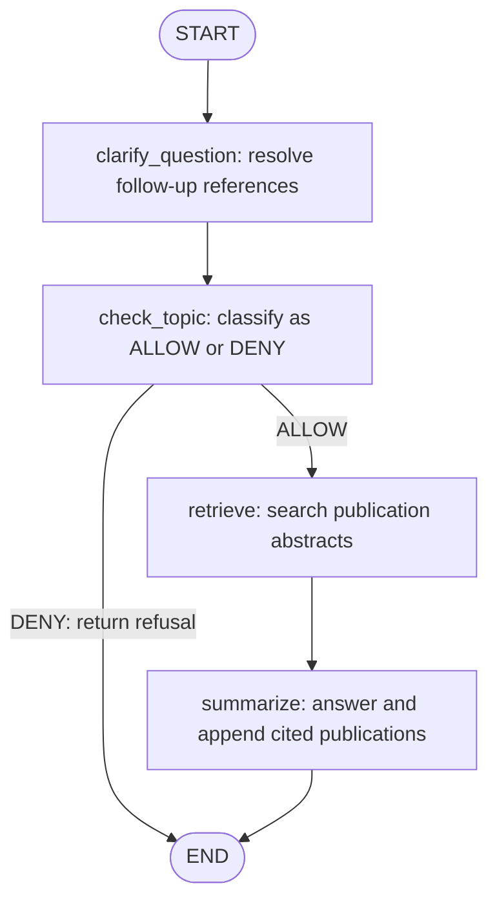

# AI Assistant Workflow

[ai_utilities.py](../src/stapp/ai_utilities.py) uses LangGraph to turn a
research question into an answer grounded in publication abstracts.
The [chat page](../src/stapp/pages/AI_explorer.py) calls this workflow and
displays the returned Markdown.

## LangGraph flow



These are the four actual graph nodes. The ALLOW/DENY labels represent the
conditional edge after `check_topic`, not extra nodes. Empty search results
are handled inside `summarize`, which returns a no-publications message.

## Step by step

1. **`clarify_question`** uses conversation history to rewrite a follow-up as
   a standalone question. With no history, it uses the original topic without
   an LLM call. A new topic should remain a new topic.
2. **`check_topic`** sends both the original message and the clarified question
   to the LLM. Only an exact `ALLOW` or `DENY` response is accepted.
   A denial ends the graph with a refusal, without retrieval or summarization.
3. **`retrieve`** calls the local `search_publications()` wrapper with the
   clarified question. The wrapper calls
   [st_utilities.search_publications()](../src/stapp/st_utilities.py) with
   `abstract=True` and converts the returned DataFrame to a list of records.
   The existing embedding search retrieves up to ten papers with nonempty
   abstracts from PostgreSQL.
4. **`summarize`** gives the LLM the original message, clarified question, and
   numbered publication titles and abstracts. Its prompt prioritizes direct
   relevance, excludes unrelated evidence, and asks for limitations and
   acknowledgment of insufficient evidence. Python then appends publication
   metadata for the cited papers.

### Topic policy

The current classifier prompt allows academic literature questions about AI,
healthcare, medicine, public health, literacy, and related computational methods.
It also allows research questions about these fields individually; a connection
between healthcare and AI is not required by the current prompt.

It instructs the model to reject unrelated subjects, direct personal medical
advice, discriminatory or exploitative requests, and the other unsafe categories
listed in the prompt. Mixed requests are checked as well.

The current refusal text describes a narrower healthcare-and-AI scope than the
classifier prompt. The prompt, rather than that refusal text or the function
docstring, defines what the model is asked to allow. Classification is an
LLM judgment, not a guaranteed security or safety boundary.

## Shared state

Each node returns updates to `WorkflowState`; LangGraph passes the updated
state to the next node.

| Field | Purpose |
|---|---|
| `topic` | Latest user message, stripped of surrounding whitespace. |
| `history` | Earlier messages, each containing `role` and `content`. |
| `question` | Standalone question produced by clarification. |
| `allowed` | Topic-check decision used by the conditional edge. |
| `publications` | Retrieved publication records, including abstracts and metadata. |
| `summary` | Final Markdown answer, refusal, or no-results message. |

`summarize_topic()` starts the graph with `topic` and `history`; the nodes
populate the remaining fields.

## Calling the workflow

From code where `ai_utilities` is importable:

```python
import ai_utilities

question = "How is AI used for early dementia detection?"
answer = ai_utilities.summarize_topic(question)

history = [
    {"role": "user", "content": question},
    {"role": "assistant", "content": answer},
]
follow_up = ai_utilities.summarize_topic(
    "What limitations do these methods have?",
    history=history,
)
```

The public function returns a string, not the complete graph state.
The graph is compiled once when the module is imported.

### Follow-ups and chat memory

The graph has no checkpointer or built-in persistent conversation memory.
The caller supplies the previous messages on each invocation.
The Streamlit page stores those messages in `st.session_state["ai_messages"]`
and passes a snapshot taken before adding the current message.

History is used to clarify the question, not passed directly to the summary
model. Every allowed turn performs a new search, so follow-ups may retrieve
different papers. Questions about the exact papers shown earlier are therefore
not guaranteed to use those same papers.

**Clear chat** empties the saved messages and removes the context for subsequent
questions. Ordinary Streamlit reruns redisplay history without invoking the
workflow again.

## Citations and publication details

- The LLM is instructed to cite original retrieval numbers separately, such as
  `[1] [3]`, without renumbering.
- Python extracts numeric citation markers and appends a **Publications**
  section only for matching retrieved papers.
- Each entry includes its number, title, authors, and DOI. Missing authors or a
  missing/unrecognized DOI display as `Not available`.
- DOI values can be plain identifiers, `doi:`-prefixed identifiers, or common
  `doi.org`/`dx.doi.org` URLs. Recognized values become `https://doi.org/...` links.
- Markdown reference definitions make inline citation numbers clickable when
  their paper has a recognized DOI.
- If no retrieved paper is cited, no publication section is appended.

Metadata comes from the retrieved records, not generated author or DOI text.
However, citation extraction is not claim verification: it does not prove that
the cited abstract supports the answer or validate every generated citation.

## Setup and execution

Use the project's Python 3.12 environment. LangGraph is declared in
[pyproject.toml](../pyproject.toml) and locked in [uv.lock](../uv.lock).
Install the project's locked dependencies:

```powershell
uv sync --locked
```

The [Dockerfile](../Dockerfile) exports the locked runtime dependencies and
installs them into the container, including LangGraph. Development dependencies
are excluded.

Configure these values in the repository-root `prod.env`:

- `OPENAI_KEY`: used for LLM calls and search embeddings.
- `NEON_DATABASE_URL`: PostgreSQL connection URI for publication retrieval.

The module loads `prod.env`; existing environment variables take precedence.
Never commit actual credentials. `MODEL` selects the LLM (currently
`gpt-6-luna`); the account must have access to the configured model.
Retrieval uses the embedding model configured in `st_utilities.py`.

Run the module's example from the repository root:

```powershell
.\.venv\Scripts\python.exe src\stapp\ai_utilities.py
```

This makes live API and database requests and prints the resulting answer.
For the chat interface, run the Streamlit app as described in the
[README](../README.md).

## Errors, cost, and limitations

- Blank topics, empty clarification/summary responses, and invalid classifier
  decisions raise `ValueError`. API, database, and configuration errors
  propagate to the caller; the workflow has no custom error-handling node.
- With no history, an allowed question with results uses two LLM calls:
  classification and summarization. With history, clarification adds a third.
  Retrieval also makes an embedding request. Denied questions skip retrieval
  and summarization; empty retrieval skips the summary LLM call.
- History is not truncated, so long conversations increase clarification cost
  and can exceed model context limits.
- Answers use abstracts, not full-text publications. Semantic retrieval does
  not guarantee relevance, and relevance filtering is prompt-based.
- Check original papers before relying on findings. This is a literature
  exploration tool, not a personal medical-advice service.
